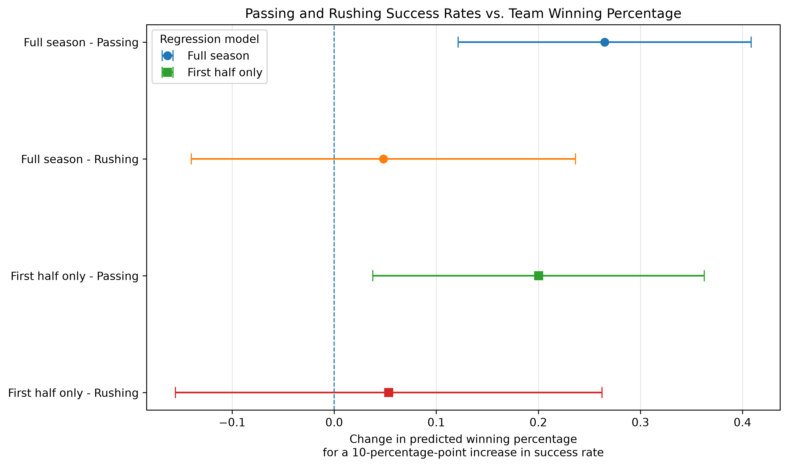
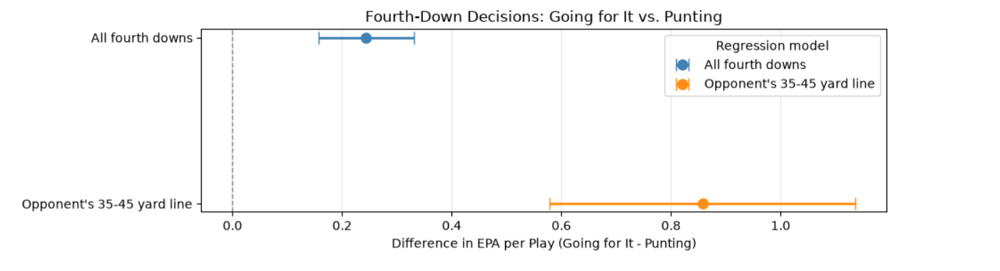

# cs418-football
cs 418 football group

# Members:
- Antonio
- John Leveille
- Kevin Cox
- Nishant

# Research Questions (Revised):
- Q1: How do rushing and passing success rates individually correlate with NFL team win percentages?
- Q2: How do yards to go and field position affect the average EPA of punting versus going for it on fourth down?
- Q3: How does average WR separation correlate with receiving yards per target, and does this relationship change based on route depth?

# Primary Datasets:
- nflverse_acquire.ipynb -> 
    - Play by Play data for 2025, can look for other seasons
    - Shape is (48771, 372)
    - Each row is one play of a game
    - Notable columns:
        posteam (team with possession), yards_gained, success, passer, rusher, receiver
    
- player_stats_acquisition.ipynb -> nflverse - https://github.com/nflverse/nflreadpy
    - Player Weekly Stats
    - Shape (94848, 150)
    - One row = stats for one player for one week
    - Notable columns:
        player_name, team, passing_yards, rushing_yards

# Secondary Datasets:
- team_stats.ipynb 
    - Team stats for the 2025 regular season
    - Shape is (32, 136)
    - Each row is one team that played in the 2025 regular 
    - Notable columns: passing_yards, rushing_yards, passing_tds, rushing_tds
- nextgen_receiving_acquisition.ipynb -> NFL Next Gen Stats Receiving Data
    - Data acquired using nflreadpy
    - 2025 regular season
    - Focused on Wide Receivers (WR)
    - Raw dataset shape: (1402, 23)
    - Filtered WR weekly observations: 888
    - Final cleaned dataset shape: (887, 19)
    - Notable columns:
        player_gsis_id, player_display_name, team_abbr, week,
        avg_separation, avg_cushion, avg_intended_air_yards,
        targets, receptions, catch_percentage, yards, avg_yac,
        avg_expected_yac, avg_yac_above_expectation
    - Created variables:
        yards_per_target, yards_per_reception
    - Used to investigate how average WR separation relates to receiving yardage
    - Cleaned dataset saved as nextgen_wr_receiving_2025.csv

# Eda:
- Reference [Eda](eda.ipynb)

# Datasheet:
- Reference [Datasheet](DATASHEET.md)
- Our biggest limitation is that we can only include plays that were properly recorded by nflverse and NFL Next Gen Stats. We have verified that all 32 NFL teams have data from all 18 weeks of regular season play. However, we cannot guarantee that all stats from those games are correct or complete.

# Main Findings (Narrative Analysis)
- Reference [Narrative](narrative.ipynb)

- Passing success rate has a stronger positive association with NFL team win % than rushing success rate, even after accounting for both variables in the same regression model.
- Going for it on fourth down is associated with higher expected points added (EPA) than punting, even after controlling for yards to go and field position, with a stronger estimated association near the opponent's 35–45 yard line.

## Finding One: Passing Success is More Strongly Associated with Winning

Passing success rate has a stronger positive association with team win % than rushing success rate. In our multiple linear regression using all 32 NFL teams during the 2025 regular season, passing success rate had a positive coefficient of 2.650 with p-value of 0.001, while rushing success rate had a coefficient of 0.482 with p-value of 0.605. Therefore, a 10% increase in passing success rate was associated with an estimated 26.5% increase in team win % while holding rushing success rate constant. On the other hand, the corresponding rushing success rate was only 4.8% and its confidence internal also included zero. These results suggest that passing success rate has a stronger independent association with win %. One possible alternative explanation is that teams who are behind may pass more often, while teams who are ahead will run more often. To check this, we repeated the regression using only first-half plays to calculate the success rates. Passing remained statistically significant with a coefficient of 2.002 and p-value of 0.017, while rushing remained statistically insignificant with a coefficient of 0.535 and p-value of 0.605. This suggests that the passing relationship is not entirely explained by late-game decisions.

## Finding Two

Going for it on fourth down has a positive association with expected points added (EPA) compared to punting. In our multiple linear regression using NFL play-by-play data from the 2021–2025 regular seasons, going for it had a positive coefficient of 0.244 with a p-value below 0.001 after controlling for yards to go and field position. This suggests that going for it was associated with approximately 0.244 additional EPA per play compared to punting when holding the other variables constant.

One possible alternative explanation is that teams choose to go for it or punt depending on their field position and game situation. To investigate this further, we repeated the regression using only fourth-down plays between the opponent's 35- and 45-yard lines, where the decision between going for it and punting may be less obvious. In this smaller sample, going for it had a positive coefficient of 0.858 with a p-value below 0.001. Both regression models had 95% confidence intervals entirely above zero, indicating statistically significant positive associations. Overall, these results suggest that going for it on fourth down is associated with higher EPA than punting, particularly around the opponent's 40-yard line. However, these results do not establish that going for it causes higher EPA, since other game situations may influence both the decision and the outcome.

